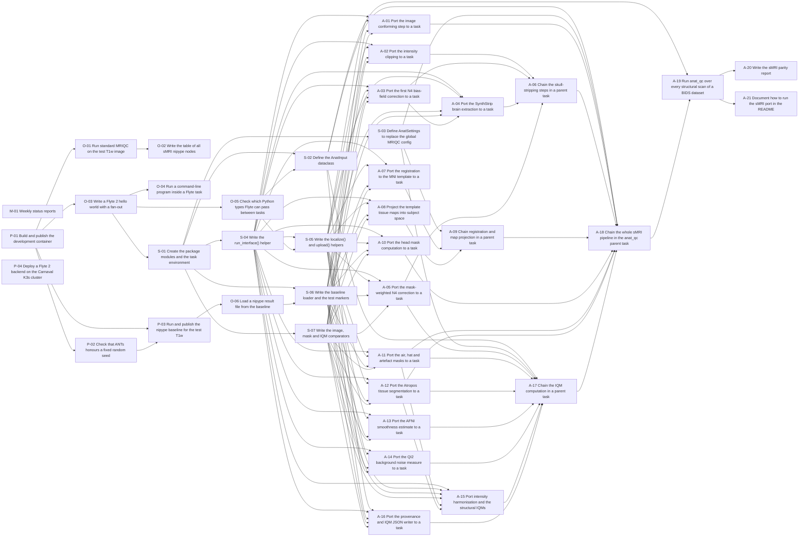

# Roadmap

Generated from the issue drafts; do not edit by hand. Each row is one GitHub issue.
Weeks: W1 = Nov 23-27, W2 = Nov 30-Dec 4, W3 = Dec 7-11, W4 = Dec 14-15 (2026).

| Tier | Hours | Issues |
|---|---|---|
| prep | 13 | 4 |
| core | 84 | 35 |
| stretch | 39.5 | 14 |
| later | 248.5 | 93 |

Core hours per week: W1 28.5 h, W2 25.5 h, W3 24 h, W4 6 h

## Prep

| ID | Week | Area | Title | Hours | Blocked by |
|---|---|---|---|---|---|
| P-01 | W0 | prep | Build and publish the development container | 4 |  |
| P-02 | W0 | prep | Check that ANTs honours a fixed random seed | 2 | P-01 |
| P-03 | W0 | prep | Run and publish the nipype baseline for the test T1w | 3 | P-01, P-02 |
| P-04 | W0 | prep | Deploy a Flyte 2 backend on the Carnaval K3s cluster | 4 |  |

## Core

| ID | Week | Area | Title | Hours | Blocked by |
|---|---|---|---|---|---|
| M-01 | W1 | meta | Weekly status reports | 1 |  |
| O-01 | W1 | onboarding | Run standard MRIQC on the test T1w image | 2 | P-01 |
| O-02 | W1 | onboarding | Write the table of all sMRI nipype nodes | 2.5 | O-01 |
| O-03 | W1 | onboarding | Write a Flyte 2 hello world with a fan-out | 1.5 | P-01 |
| O-04 | W1 | onboarding | Run a command-line program inside a Flyte task | 2 | O-03 |
| O-05 | W1 | onboarding | Check which Python types Flyte can pass between tasks | 2 | O-03 |
| O-06 | W1 | onboarding | Load a nipype result file from the baseline | 1.5 | P-03 |
| S-01 | W1 | scaffold | Create the package modules and the task environment | 1.5 | O-03 |
| S-02 | W1 | scaffold | Define the AnatInput dataclass | 1.5 | S-01, O-05 |
| S-03 | W1 | scaffold | Define AnatSettings to replace the global MRIQC config | 2 | S-01 |
| S-04 | W1 | scaffold | Write the run_interface() helper | 3 | S-01 |
| S-05 | W1 | scaffold | Write the localize() and upload() helpers | 2 | S-04, O-05 |
| S-06 | W1 | scaffold | Write the baseline loader and the test markers | 3 | S-01, O-06 |
| S-07 | W1 | scaffold | Write the image, mask and IQM comparators | 3 | S-01 |
| A-01 | W2 | smri | Port the image conforming step to a task | 1.5 | S-04, S-05, S-06, S-07 |
| A-02 | W2 | smri | Port the intensity clipping to a task | 1.5 | S-04, S-05, S-06, S-07 |
| A-03 | W2 | smri | Port the first N4 bias-field correction to a task | 2 | S-04, S-05, S-06, S-07 |
| A-04 | W2 | smri | Port the SynthStrip brain extraction to a task | 2.5 | S-04, S-05, S-06, S-07, A-03 |
| A-05 | W2 | smri | Port the mask-weighted N4 correction to a task | 2 | S-04, S-05, S-06, S-07 |
| A-06 | W2 | smri | Chain the skull-stripping steps in a parent task | 2 | A-02, A-03, A-04, A-05 |
| A-07 | W2 | smri | Port the registration to the MNI template to a task | 4 | S-04, S-05, S-06, S-07 |
| A-08 | W2 | smri | Project the template tissue maps into subject space | 3 | S-04, S-05, S-06, S-07 |
| A-09 | W2 | smri | Chain registration and map projection in a parent task | 2 | S-03, A-07, A-08 |
| A-10 | W2 | smri | Port the head mask computation to a task | 3 | S-04, S-05, S-06, S-07 |
| A-11 | W2 | smri | Port the air, hat and artefact masks to a task | 2 | S-04, S-05, S-06, S-07 |
| A-12 | W3 | smri | Port the Atropos tissue segmentation to a task | 3.5 | S-04, S-05, S-06, S-07 |
| A-13 | W3 | smri | Port the AFNI smoothness estimate to a task | 2 | S-04, S-05, S-06, S-07 |
| A-14 | W3 | smri | Port the QI2 background noise measure to a task | 1.5 | S-04, S-05, S-06, S-07 |
| A-15 | W3 | smri | Port intensity harmonisation and the structural IQMs | 3 | S-04, S-05, S-06, S-07, A-11, A-12 |
| A-16 | W3 | smri | Port the provenance and IQM JSON writer to a task | 4 | S-02, S-04, S-05, S-06, S-07 |
| A-17 | W3 | smri | Chain the IQM computation in a parent task | 3 | S-02, S-03, A-05, A-11, A-12, A-13, A-14, A-15, A-16 |
| A-18 | W3 | smri | Chain the whole sMRI pipeline in the anat_qc parent task | 4 | S-02, S-03, A-01, A-06, A-09, A-10, A-11, A-12, A-17 |
| A-19 | W3 | smri | Run anat_qc over every structural scan of a BIDS dataset | 3 | S-02, A-18 |
| A-20 | W4 | smri | Write the sMRI parity report | 4 | A-19 |
| A-21 | W4 | smri | Document how to run the sMRI port in the README | 2 | A-19 |

## Stretch

| ID | Week | Area | Title | Hours | Blocked by |
|---|---|---|---|---|---|
| I-01 | none | integration | Write the anat mosaics task | 2.5 | S-04, S-05, S-06, A-01, A-04 |
| I-02 | none | integration | Write the reportlet sink task | 2 | S-02, S-04, S-05, S-06 |
| I-03 | none | integration | Write the anat_report parent task | 2 | I-01, I-02, A-18 |
| I-04 | none | integration | Build the HTML report via mriqc.reports | 4 | I-03, A-16 |
| I-05 | none | integration | Add the mriqc-flyte CLI entry point | 3 | S-02, S-03, A-19 |
| I-06 | none | integration | Write a caching demo | 2 | A-19 |
| I-07 | none | integration | Compare nipype and Flyte timing on the circle-tests T1w images | 2 | A-19 |
| I-08 | none | integration | Run the port on a T2w image | 3.5 | A-19, A-20 |
| I-09 | none | integration | Write the verbose reportlets | 3.5 | I-03, A-07, A-10, A-11, A-12, A-14 |
| I-10 | none | integration | Write the IQM upload task for the MRIQC web API | 3 | S-03, S-04, S-05, A-16, A-18 |
| I-11 | none | integration | Split the task environments by memory needs | 3 | S-01, A-04, A-07, A-12 |
| X-01 | none | deployment | Build the Flyte image with Image.from_base | 3 | P-01, S-01 |
| X-02 | none | deployment | Run the sMRI port on a local devbox | 3 | X-01, A-19 |
| X-03 | none | deployment | Run the sMRI port on the Carnaval K3s backend | 3 | P-04, X-02 |

## Later

| ID | Week | Area | Title | Hours | Blocked by |
|---|---|---|---|---|---|
| D-01 | none | dmri | Run and publish the nipype baseline for one DWI dataset | 4 | P-01, P-02, P-03 |
| D-02 | none | dmri | Define DwiInput and DwiSettings | 3 | S-02, S-03 |
| D-03 | none | dmri | Add the dwi module, its task environment and baseline access | 1.5 | S-01, S-06, D-01, F-03 |
| D-04 | none | dmri | Port the q-space neighbours and the shell detection | 3 | S-04, S-05, S-07, D-03 |
| D-05 | none | dmri | Port the volume extraction and reuse the sanitising task | 2.5 | S-04, S-05, S-07, D-03, F-07 |
| D-06 | none | dmri | Port the b=0 reference and the per-shell average maps | 3 | S-04, S-05, S-07, D-03 |
| D-07 | none | dmri | Check the shared skull-strip and head-motion tasks on DWI | 2.5 | D-02, D-03, A-06, F-05 |
| D-08 | none | dmri | Port the signal drift correction without mriqc.config | 3 | S-04, S-05, S-07, D-03 |
| D-09 | none | dmri | Port the MRtrix3 denoising to a task | 2 | S-04, S-05, S-07, D-03 |
| D-10 | none | dmri | Port the spiking-voxels mask and the PIESNO noise estimate | 2.5 | S-04, S-05, S-07, D-03 |
| D-11 | none | dmri | Port the DTI and DKI model fit to a task | 3 | S-04, S-05, S-07, D-03, D-04 |
| D-12 | none | dmri | Port the corpus callosum segmentation to a task | 2 | S-04, S-05, S-07, D-03, D-11 |
| D-13 | none | dmri | Port the b-vector rotation to a task | 2 | S-04, S-05, S-07, D-03 |
| D-14 | none | dmri | Write the dMRI head-motion parent task | 2.5 | D-07, D-13, F-05, F-06 |
| D-15 | none | dmri | Reuse the EPI to MNI alignment for the DWI reference | 2 | D-02, D-03, F-15 |
| D-16 | none | dmri | Port the noise floor and the diffusion IQMs | 3.5 | S-04, S-05, S-07, D-03, D-04, D-11, D-12, D-14 |
| D-17 | none | dmri | Write the dMRI IQMs and provenance to JSON | 2.5 | D-02, D-04, D-16, A-16 |
| D-18 | none | dmri | Port the FA, MD, background and SNR reportlets | 3.5 | S-04, S-05, D-03, I-01 |
| D-19 | none | dmri | Port the white-matter mask and the FA heatmap reportlet | 2.5 | S-04, S-05, D-03, D-04, I-01 |
| D-20 | none | dmri | Write the dMRI report parent task | 3 | D-18, D-19, I-02 |
| D-21 | none | dmri | Write the dMRI preparation parent task | 3 | D-02, D-04, D-05, D-06, D-07, D-08 |
| D-22 | none | dmri | Write the dMRI model and derivatives parent task | 3.5 | D-09, D-10, D-11, D-12, D-14, D-15, D-21 |
| D-23 | none | dmri | Write the dwi_qc parent task | 2.5 | D-16, D-17, D-20, D-22 |
| D-24 | none | dmri | Add DWI inputs to the main entry task | 2 | D-02, D-23, A-19 |
| D-25 | none | dmri | Check end-to-end dMRI parity with the baseline | 3 | D-01, D-24 |
| D-26 | none | dmri | Write the dMRI parity report | 2 | D-25 |
| F-01 | none | fmri | Run and publish the nipype fMRI baseline for one BOLD run | 4 | P-01, P-02, P-03 |
| F-02 | none | fmri | Define the FuncInput and FuncSettings dataclasses | 3 | S-02, S-03, F-03 |
| F-03 | none | fmri | Add func_env and point the baseline loader at the fMRI baseline | 2 | S-01, S-06, F-01 |
| F-04 | none | fmri | Port the echo selection and non-steady-state detection | 2 | S-04, S-05, S-07, F-03 |
| F-05 | none | fmri | Port the head-motion estimation (3dvolreg) to a shared task | 2.5 | S-04, S-05, S-07, F-03 |
| F-06 | none | fmri | Port the framewise displacement computation to a shared task | 1.5 | S-04, S-05, S-07, F-03 |
| F-07 | none | fmri | Port the image sanitising that drops the dummy volumes | 2 | S-04, S-05, S-07, F-03 |
| F-08 | none | fmri | Port the per-echo realignment with nitransforms | 3 | S-04, S-05, S-07, F-03 |
| F-09 | none | fmri | Write the hmc parent task for the default options | 3 | F-02, F-05, F-06, F-08 |
| F-10 | none | fmri | Port the mean EPI and temporal SNR maps | 2 | S-04, S-05, S-07, F-03 |
| F-11 | none | fmri | Skull-strip the mean EPI with the shared skullstrip task | 1.5 | A-06, F-02, F-03 |
| F-12 | none | fmri | Port the EPI sharpening (N4) to a shared task | 1.5 | S-04, S-05, S-07, F-03 |
| F-13 | none | fmri | Port the EPI to MNI registration to a shared task | 3.5 | S-04, S-05, S-07, F-03, A-07 |
| F-14 | none | fmri | Port the resampling of the carpet segmentation to a shared task | 2 | S-04, S-05, S-07, F-03 |
| F-15 | none | fmri | Write the epi_mni_align parent task in shared.py | 2 | F-12, F-13, F-14 |
| F-16 | none | fmri | Port the DVARS computation to a task | 1.5 | S-04, S-05, S-07, F-03 |
| F-17 | none | fmri | Reuse the FWHM task for the smoothness of the mean EPI | 1.5 | A-13, F-03 |
| F-18 | none | fmri | Port the AFNI outlier, quality index and GCOR measures | 3 | S-04, S-05, S-07, F-03 |
| F-19 | none | fmri | Port the functional IQMs (FunctionalQC) to a task | 3 | S-04, S-05, S-07, F-03 |
| F-20 | none | fmri | Port the timeseries TSV and its sidecar to a task | 2 | S-04, S-05, S-07, F-03 |
| F-21 | none | fmri | Write the fMRI IQM JSON with its provenance | 3 | S-04, S-05, S-07, F-03, A-16 |
| F-22 | none | fmri | Write the compute_func_iqms parent task | 3.5 | F-02, F-16, F-17, F-18, F-19, F-20, F-21 |
| F-23 | none | fmri | Port the background spike series for the carpet plot | 2 | S-04, S-05, S-07, F-03 |
| F-24 | none | fmri | Port the carpet parcellation with its crown mask | 2 | S-04, S-05, S-07, F-03 |
| F-25 | none | fmri | Port the carpet plot (FMRISummary) to a task | 2 | S-04, S-05, F-03 |
| F-26 | none | fmri | Port the four fMRI mosaic reportlets | 2 | S-04, S-05, F-03, I-01 |
| F-27 | none | fmri | Write the func_report parent task | 3 | F-02, F-10, F-22, F-23, F-24, F-25, F-26, I-02 |
| F-28 | none | fmri | Write the fmri_qc parent task for one run | 4 | F-02, F-04, F-07, F-09, F-10, F-11, F-15, F-22, F-27 |
| F-29 | none | fmri | Fan out the fMRI workflow over all runs and echoes | 4 | F-02, F-28, A-19 |
| F-30 | none | fmri | Check end-to-end fMRI parity against the nipype baseline | 3 | S-07, F-01, F-29 |
| F-31 | none | fmri | Write the fMRI parity report | 2 | F-30 |
| F-32 | none | fmri | Add 3dDespike and 3drefit to the development image | 2.5 | P-01, P-02, F-01 |
| F-33 | none | fmri | Port the despike and deoblique options of the hmc task | 3 | F-09, F-28, F-32 |
| F-34 | none | fmri | Port the FFT spike detector option | 3.5 | F-22, F-27 |
| G-01 | none | group | Aggregate the IQM JSON files into group_T1w.tsv | 2 | A-16, A-19 |
| G-02 | none | group | Generate the group HTML report | 2 | G-01 |
| G-03 | none | group | Extend the group outputs to BOLD and DWI | 2 | G-01, G-02 |
| G-04 | none | group | Add the species setting and record a rat baseline | 3.5 | S-03, S-06 |
| G-05 | none | group | Port the rodent brain extraction to a task | 4 | G-04, A-06, A-18 |
| G-06 | none | group | Apply the rodent templates and thresholds in the sMRI tasks | 4 | G-04, A-07, A-08, A-10, A-15 |
| N-01 | none | stage-2 | Vendor MRIQC's anatomical IQM functions without the config import | 3 | S-01 |
| N-02 | none | stage-2 | Write the run_command() helper and a command-line comparator | 2.5 | S-04, S-06 |
| N-03 | none | stage-2 | Rewrite conform and clip_intensity with nibabel only | 2.5 | A-01, A-02 |
| N-04 | none | stage-2 | Build the N4 command line and rewrite n4_pre without nipype | 3 | A-03, N-02 |
| N-05 | none | stage-2 | Rewrite n4_post with the weight image and the bias field output | 2 | A-05, N-04 |
| N-06 | none | stage-2 | Rewrite synthstrip to call MRIQC's bundled SynthStrip program | 2 | A-04, N-02 |
| N-07 | none | stage-2 | Prepare the registration inputs and the initial affine transform | 3 | A-07, N-02 |
| N-08 | none | stage-2 | Build the antsRegistration command line from the JSON presets | 3.5 | N-07 |
| N-09 | none | stage-2 | Run antsRegistration with the preset fallback and draw its report | 3.5 | N-08, N-10 |
| N-10 | none | stage-2 | Rewrite project_tpms with antsApplyTransforms and the header fix | 2 | A-08, N-02 |
| N-11 | none | stage-2 | Rewrite head_mask with vendored functions and a numpy ApplyMask | 2 | A-10 |
| N-12 | none | stage-2 | Rewrite air_masks without the RotationMask and ArtifactMask classes | 3 | A-11, N-01 |
| N-13 | none | stage-2 | Rewrite segment_tissues by calling Atropos directly | 3 | A-12, N-02 |
| N-14 | none | stage-2 | Rewrite estimate_fwhm with 3dFWHMx and its output parsing | 2 | A-13, N-02 |
| N-15 | none | stage-2 | Rewrite compute_qi2 with the vendored art_qi2 function | 1.5 | A-14, N-01 |
| N-16 | none | stage-2 | Rewrite structural_measures as plain functions over the vendored IQMs | 3 | A-15, N-01 |
| N-17 | none | stage-2 | Write the IQM JSON and its provenance without IQMFileSink | 3 | A-16 |
| N-18 | none | stage-2 | Add a CI check that the sMRI path never imports nipype | 2.5 | N-03, N-05, N-06, N-09, N-11, N-12, N-13, N-14, N-15, N-16, N-17 |
| N-19 | none | stage-2 | Make nipype an optional dependency of the sMRI install | 3.5 | N-18 |
| N-20 | none | stage-2 | Rewrite the head-motion estimation by calling 3dvolreg directly | 2 | F-05, D-07, N-02 |
| N-21 | none | stage-2 | Rewrite the EPI to MNI alignment with the sMRI command builders | 3.5 | F-12, F-13, F-14, N-04, N-09, N-10 |
| N-22 | none | stage-2 | Rewrite the AFNI temporal measures with direct program calls | 3.5 | F-10, F-18, N-02 |
| N-23 | none | stage-2 | Rewrite the dMRI denoising by calling MRtrix3 dwidenoise directly | 2 | D-09, N-02 |
| X-04 | none | deployment | Run one participant per sbatch job with Apptainer | 4 | P-01, I-05 |
| X-05 | none | deployment | Evaluate the flyteplugins-slurm connector | 3 | X-03, X-04 |
| X-06 | none | deployment | Measure the object-store traffic of one sMRI run | 3 | X-02 |
| X-07 | none | deployment | Write the HPC deployment guide | 4 | X-02, X-03, X-04, X-05, X-06 |

## Core dependency graph

